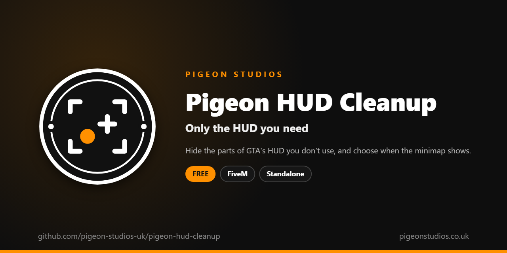

<div align="center">
  

  <h1>Pigeon HUD Cleanup</h1>

  <p><strong>Hides the parts of GTA's HUD you choose, from cash and area names to the crosshair, and sets when the minimap shows.</strong></p>

  <p>
    <a href="https://github.com/pigeon-studios-uk/pigeon-hud-cleanup/releases/latest"></a>
    <a href="LICENSE.md"></a>
    <a href="https://discord.gg/2NFVWEUmDF"></a>
    
  </p>

  <p>
    <a href="https://github.com/pigeon-studios-uk/pigeon-hud-cleanup/releases/latest"><strong>Download</strong></a> ·
    <a href="#installation">Install</a> ·
    <a href="#configuration">Configure</a> ·
    <a href="CHANGELOG.md">Changelog</a> ·
    <a href="https://discord.gg/2NFVWEUmDF">Support</a>
  </p>
</div>

---

## Contents

- [Overview](#overview)
- [Features](#features)
- [Requirements](#requirements)
- [Installation](#installation)
- [Updating](#updating)
- [Configuration](#configuration)
- [How it works](#how-it-works)
- [Update checker](#update-checker)
- [Performance](#performance)
- [Security](#security)
- [Troubleshooting](#troubleshooting)
- [FAQ](#faq)
- [Support](#support)
- [Contributing](#contributing)
- [Licence](#licence)
- [Credits](#credits)

## Overview

Pigeon HUD Cleanup is a free resource by [Pigeon Studios](https://pigeonstudios.co.uk) that clears away the parts of GTA's HUD a roleplay server doesn't use. GTA shows story-mode cash, Online cash, wanted stars, the car's name every time you get in, the area and street name in the corner, and more, often underneath or on top of your server's own HUD.

Choose exactly which parts to hide. Out of the box, it hides cash, wanted stars and the vehicle, area and street names, and keeps the crosshair and weapon icon. The minimap can stay, show only in vehicles, or go completely.

## Features

- **Fourteen HUD parts, each your choice.** Cash, Online cash, cash changes, wanted stars, vehicle name and class, area and street names, the radio station name, the weapon icon, the weapon wheel's stat bars, the crosshair, the saving spinner and GTA Online's messages.
- **Crosshair your way.** Hide it, but keep it for sniper rifles if you like.
- **Minimap when you want it.** Always, only in vehicles, or never.
- **Safe.** Help text, the weapon wheel and subtitles are never hidden, because players need them.
- **Undoes itself.** Stopping the resource brings the minimap back, and GTA shows everything else again straight away.
- **Standalone.** No framework or other resources needed.

## Requirements

| Requirement | Version | Notes |
|---|---|---|
| FXServer | A [recommended artifact](https://runtime.fivem.net/artifacts/) | |

**Frameworks:** none needed. It works the same on standalone and vMenu servers, ESX Legacy, QBCore, Qbox and ox_core.

## Installation

1. **Download** `pigeon-hud-cleanup.zip` from the [latest release](https://github.com/pigeon-studios-uk/pigeon-hud-cleanup/releases/latest). Don't use the green **Code** button; release zips are the tested builds.
2. **Extract** it into your server's `resources` folder. The folder must be called `pigeon-hud-cleanup`.
3. **Start it** by adding this to `server.cfg`:

   ```cfg
   ensure pigeon-hud-cleanup
   ```

4. **Choose what to hide** in `configuration/config.lua`. The defaults suit most roleplay servers.
5. **Restart** your server. The console shows one line from the update checker:

   ```text
   [Pigeon Studios] Pigeon HUD Cleanup v1.0.0 is up to date.
   ```

## Updating

1. Read the [changelog](CHANGELOG.md) for every version between yours and the latest, especially any **Upgrade notes**.
2. Back up your `configuration/` folder.
3. Replace the `pigeon-hud-cleanup` folder with the new release.
4. Copy your changed settings into the new `configuration/config.lua`. Don't copy the old file over the new one; new versions can add settings.
5. Restart the resource.

## Configuration

All settings are in `configuration/config.lua`, each explained by a comment next to it.

`Config.Hide` has one line per HUD part: `true` hides it, `false` keeps it.

| Part | Default | What it is |
|---|---|---|
| `wanted_stars` | hidden | The wanted level stars |
| `cash` | hidden | Story-mode cash, top right |
| `online_cash` | hidden | GTA Online cash and bank, top right |
| `cash_change` | hidden | The "+$100" that pops up when cash changes |
| `vehicle_name` | hidden | The vehicle's name, bottom right, when you get in |
| `vehicle_class` | hidden | The vehicle's class, under its name |
| `area_name` | hidden | The area's name, such as "Vinewood" |
| `street_name` | hidden | The street's name |
| `radio_station` | kept | The station's name when the radio changes |
| `weapon_icon` | kept | The weapon and ammo, top right, when switching weapons |
| `weapon_wheel_stats` | hidden | The damage, fire rate and range bars on the weapon wheel |
| `reticle` | kept | The crosshair while aiming |
| `saving_game` | hidden | The "saving" spinner, bottom right |
| `online_message` | kept | GTA Online's big messages in the middle of the screen |

| Setting | Default | What it does |
|---|---|---|
| `Config.KeepSniperReticle` | `true` | With the crosshair hidden, keep it for sniper rifles |
| `Config.Minimap` | `'always'` | `'always'`, `'vehicle'` (only in vehicles) or `'never'`. The health and armour bars go with it |

## How it works

GTA only hides a HUD part for the frame it's told to, so every frame the resource calls `HideHudComponentThisFrame` once for each part set to `true` in `Config.Hide`. With `Config.KeepSniperReticle`, the crosshair is skipped while the player holds a sniper rifle (`GetWeapontypeGroup`).

The minimap is shown or hidden with `DisplayRadar`, only when the answer changes: on start, and when a player with `'vehicle'` gets in or out of a vehicle. When the resource stops, the minimap is shown again, and GTA shows every other part again on the next frame by itself.

## Update checker

When it starts, Pigeon HUD Cleanup checks our public [version registry](https://github.com/pigeon-studios-uk/pigeon-versions) once and prints one line in the server console saying whether it's up to date. If there's an update, it shows what's new and where to get it. The check is a single request to GitHub and sends nothing about your server or players.

Control it for every Pigeon Studios resource at once in `server.cfg`:

```cfg
set pigeon_update_check "on"      # default: one line per resource
set pigeon_update_check "quiet"   # only when there's an update or a problem
set pigeon_update_check "off"     # never check
```

## Performance

It runs every frame, as GTA requires for hiding HUD parts, but each frame is one quick call per hidden part. Nothing runs on the server apart from the update check at start-up.

## Security

- It runs only in each player's own game and only changes what their HUD shows.
- It has no commands, exports or network events, so there is nothing other players, other resources or the server can send it.
- The only network request is the update check at start-up, from the server to GitHub. It sends nothing about your server or players.

Found a problem? Please don't open a public issue. Use the **Report a vulnerability** button in this repository's **Security** tab, or follow our [Security Policy](https://github.com/pigeon-studios-uk/.github/blob/main/SECURITY.md).

## Troubleshooting

**A part I hid still shows.**
Check the resource is started and there are no errors in the F8 console, and that the part is `true` in `Config.Hide`. Some HUD resources draw their own copy of a part, such as cash; that's theirs to hide.

**The minimap keeps coming back.**
Another resource, often your HUD, is showing it too. Turn off its minimap setting, or leave `Config.Minimap = 'always'` and let your HUD decide.

**The health and armour bars are gone.**
They're part of GTA's minimap, so they go with it. Most server HUDs show their own.

**The console says "isn't in the version registry" or "couldn't check for updates".**
Your server couldn't reach GitHub, or the check is blocked by a firewall. The resource works normally either way. Turn the check off with `set pigeon_update_check "off"`.

## FAQ

**Is it really free?**
Yes. Use it on as many servers as you like, including ones that take donations. You just can't reupload, resell or bundle it. See [Licence](#licence).

**Does it work on standalone and vMenu servers?**
Yes. It needs no framework at all. vMenu's own "hide HUD" and "hide radar" options can still turn everything off for a player; this resource only decides what's shown when they're on.

**Does it work with my HUD resource?**
Yes. It only hides GTA's own HUD. Your HUD resource's own display isn't touched.

## Support

Read [Troubleshooting](#troubleshooting) first, then ask in the support channels of our [Discord](https://discord.gg/2NFVWEUmDF). Please include your Pigeon HUD Cleanup version, FXServer artifact, your HUD resource and any errors from the console (F8 in game). See [Getting help](https://github.com/pigeon-studios-uk/.github/blob/main/SUPPORT.md).

Found a bug? Open a [bug report](https://github.com/pigeon-studios-uk/pigeon-hud-cleanup/issues/new/choose).

## Contributing

Fixes and improvements are welcome. Please read the [contributing guide](https://github.com/pigeon-studios-uk/.github/blob/main/CONTRIBUTING.md) first, and open a feature request before working on anything big.

## Licence

Pigeon HUD Cleanup is free to use under the **[Pigeon Studios Free Licence](LICENSE.md)**.

- ✅ Use it on any number of servers, including monetised ones
- ✅ Change it for your own servers
- ✅ Show it in videos and streams
- ❌ Don't reupload, share or mirror the files; link to this repository instead
- ❌ Don't sell it, bundle it in packs, or put it behind escrow
- ❌ Don't remove the credits

This summary isn't the licence; [LICENSE.md](LICENSE.md) is. Third-party components are listed in [NOTICE.md](NOTICE.md).

## Credits

Made by [Pigeon Studios](https://pigeonstudios.co.uk). Thanks to everyone who has contributed fixes; see the [changelog](CHANGELOG.md).

<sub>Not affiliated with or endorsed by Rockstar Games, Take-Two Interactive or Cfx.re.</sub>
